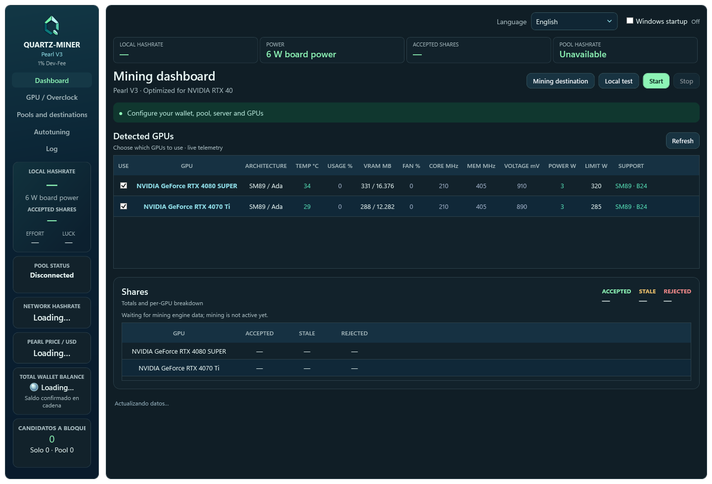
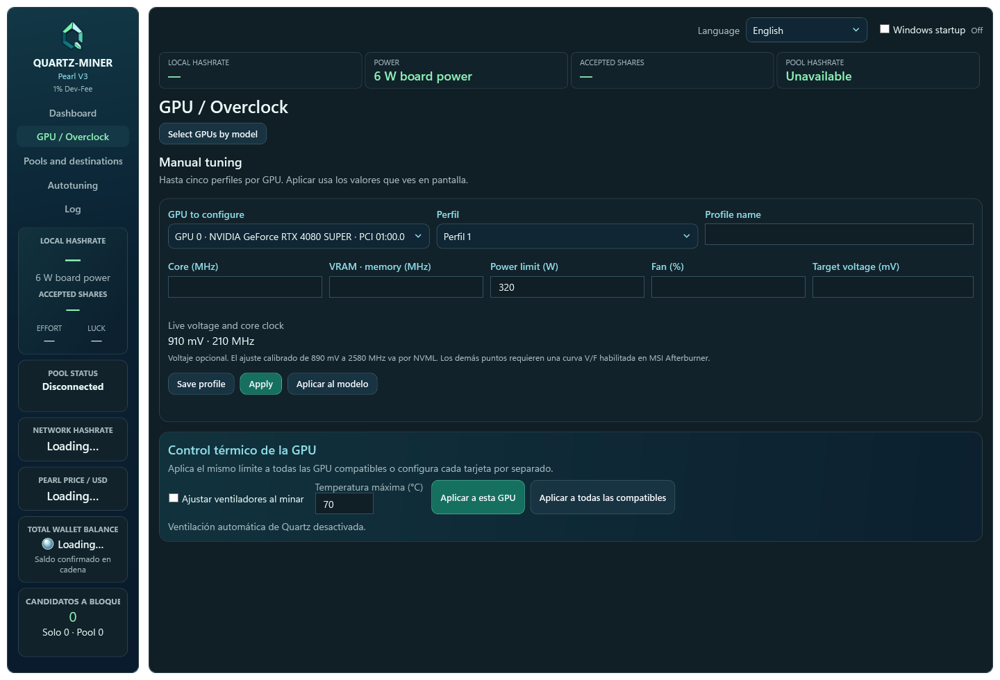

# Quartz-Miner

Quartz-Miner is a Windows x64 CUDA GPU miner for Pearl (PRL) V3 using PearlHash. Version 1.0.12 is optimized for **NVIDIA GeForce RTX 40 series**. The panel manages Stratum destinations, GPU selection, live telemetry, thermal limits, and named tuning profiles.

## Pearl V4 / FP8 development status

Quartz integrates experimental V4 job and GPU routing. In local PearlGateway tests, a factory-profile RTX 4070 Ti computed fresh FP8 tickets for V4 jobs. Rust verified each proof before submission and the receiving service verified the same bytes. When the job changed during CUDA execution, Quartz withheld the superseded proof and sent only the current one.

**The public ZIP mines V3.** B24 remains the production engine for eligible Ada GPUs. FP8 Ada is disabled in production pending Pearl profile admission and validation with a compatible testnet pool. Local gateway results do not establish mainnet or pool support. RTX 50 hardware testing is pending.

## NVIDIA GPU compatibility

| GPU family | Engine in 1.0.12 | Validation |
| --- | --- | --- |
| **RTX 4070 Ti and RTX 4080 SUPER** | Optimized B24 (Ada SM 8.9) | Both models tested on hardware with Rust-verified work and accepted Pearl V3 pool shares |
| **Other RTX 40 and Ada workstation GPUs** | Optimized B24 (Ada SM 8.9) | Physical testing on other models is pending. Quartz checks each unqualified card locally before pool mining |
| **Ampere RTX 30 and Ampere workstation GPUs** | Native CUDA compatibility mode | Driver and device checks apply. Physical Ampere testing is pending |
| **RTX 50 and Blackwell workstation GPUs** | V3 native CUDA compatibility mode | Driver and device checks apply. RTX 50 has not been tested on hardware. V4 on RTX 50 is not qualified |
| **NVIDIA H100 and H200 (Hopper SM 9.0)** | Pearl V3 CUDA compatibility mode | Reported working in V3. Per-model driver and pool receipts are pending |
| **Other Hopper and Blackwell data center GPUs** | Pearl V3 CUDA compatibility mode with a supported Windows driver | Device qualification is pending |
| **RTX 2050 and RTX 3050 Laptop GPUs reporting 8.6** | Ampere compatibility | Local Rust preflight required; physical and pool tests pending |
| **RTX 3050 A Laptop GPU reporting 8.9** | Native Ada B24 | Local Rust preflight required; physical and pool tests pending |
| **Turing RTX 20 (7.5), GTX, AMD and Intel** | Unsupported in this release | The packaged engine requires an Ampere-class CUDA device or later |

Quartz selects the CUDA image by each GPU’s PCI address. In a mixed rig, Ada GPUs keep the optimized B24 kernel while eligible Ampere, Hopper and Blackwell GPUs use the compatibility image. The panel verifies work from each compatibility GPU against Rust before starting pool mining. All selected GPUs share one Stratum connection.

**Mixed-rig test coverage.** A local Stratum test loaded both images on two physical Ada cards. The RTX 4080 SUPER ran B24 and the RTX 4070 Ti was deliberately assigned the compatibility image. An independent Rust verifier accepted 12 distinct proofs across the two cards. Physical rigs combining different GPU generations are still awaiting testing. [NVIDIA GPU compute capabilities](https://developer.nvidia.com/cuda/gpus)

Autotuning is available on the two qualified models. Clock, fan, voltage and power controls depend on the individual card and driver.

## Latest FIX — flexible GPU tuning and model recommendations

- GPU tuning starts blank. Choose a saved profile or enter the settings you want to change. Empty fields preserve the current settings.
- Both Apply controls can change the core during mining. Native clock control passes the requested frequency to NVIDIA. The panel reports the measured clock under load. Explicit voltage still requires a supported driver calibration or an available V/F curve.
- **Load recommendation** fills an editable draft for the exact GPU model. External reference profiles fill core and power only. Displayed measurements are for reference. Review the values before applying.
- V3 startup checks the driver resources by PCI on compatibility GPUs. Share replies are tracked by request ID and rejected shares are attributed by PCI where available. Physical RTX 30 and RTX 50 qualification is pending.

## Download Quartz Miner for Windows

1. Download [Quartz-Miner v1.0.12 FIX](https://github.com/xxfalaxx/Quartz-Miner/releases/download/v1.0.12/Quartz-Miner-v1.0.12-win-x64-FIX.zip) and [SHA256SUMS.txt](https://github.com/xxfalaxx/Quartz-Miner/releases/download/v1.0.12/SHA256SUMS.txt). Compare the archive hash with the published SHA-256.
2. Extract the entire ZIP to a local folder and open `Quartz-Miner.Panel.exe`. The package includes its .NET and Visual C++ runtimes. When Windows requests elevation, GPU controls use the administrator context.
3. Open **Mining destination**, select a pool and server, and enter your PRL wallet or that pool's supported mining username. Apply the destination and give it a name if you want to save it. A fresh installation starts with blank account fields and no saved destinations or GPU profiles.
4. Choose your GPUs on the **Dashboard**. Run **Local test**, then **Start**. Use **GPU / Overclock** for per-card settings, model groups and thermal limits. With mining stopped, use **Reset GPU** to restore the selected card's factory settings. Saved profiles remain available.
5. Use **Stop** before closing the panel. The panel attempts to restore settings it applied for the mining session.

Windows x64 and a supported NVIDIA display driver are required. Driver 621.24 was used for qualification. NVIDIA driver branch R620 or later is recommended for the included CUDA 13.5 images. Normal mining uses the bundled runtimes and requires no CUDA Toolkit, Python, Rust, or separate .NET installation. The optional external voltage-curve control requires a compatible MSI Afterburner installation on cards without native calibrated voltage controls. [CUDA driver requirements](https://docs.nvidia.com/cuda/cuda-toolkit-release-notes/)

## Create a Pearl wallet

1. Download the Windows installer from [Pearl Research Labs' official desktop wallet release](https://github.com/pearl-research-labs/pearl/releases/tag/pearl-wallet-v3.0.0).
2. Open the wallet, create a new wallet, and follow the official guide to [back up your recovery phrase](https://help.pearlresearch.ai/hc/en-us/articles/49188981821457-Backing-up-your-wallet). Keep the phrase offline.
3. Copy a Pearl mainnet receiving address (typically `prl1p…`) and paste only that public address into **Mining destination**. If your pool uses a mining account instead, use the account format it specifies.

Use the [official Pearl block explorer](https://explorer.pearlresearch.ai/) to check a public address or block. Quartz-Miner never needs your recovery phrase or private keys.

## Pearl spot markets

- [SafeTrade · PEARL/USDT](https://safetrade.com/exchange/PEARL-USDT)
- [BigONE · PEARL/USDT](https://big.one/en/trade/PEARL-USDT)
- [Gate · PEARL/USDT](https://www.gate.com/trade/PEARL_USDT)

Look for Pearl Research Labs' **PEARL** asset. Some exchanges previously used **PRL**, which can also refer to a different asset. Check native Pearl deposit and withdrawal availability for your account before transferring.

## Developer fee

The panel shows **1% Dev-Fee**. Quartz schedules up to 30 seconds of developer mining after accruing 49 minutes 30 seconds of connected primary mining. A normal stop saves any time already accrued, including unspent credit from a partial fee window. Pool charges are separate. Local tests do not mine to a pool.

## Panel

## Report a problem

Use [Issues → New issue](https://github.com/xxfalaxx/Quartz-Miner/issues/new/choose) and select **Bug report**. Include the release version, GPU model, NVIDIA driver and the steps to reproduce. Remove mining accounts, wallet addresses, credentials and private paths from attachments.
